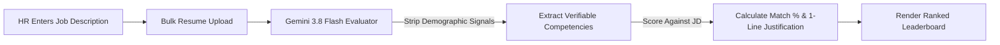
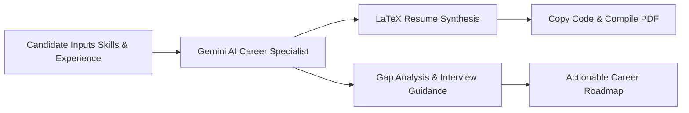

# HireMe ⚡

<p align="center">
  <strong>Next-Generation AI Recruitment & ATS Resume Optimization Engine</strong>
</p>

<p align="center">
  <em>Eliminating unconscious bias in talent acquisition while empowering candidates with ATS-optimized LaTeX resumes and actionable interview gap analysis.</em>
</p>

<p align="center">
  <a href="https://nextjs.org"></a>
  <a href="https://react.dev"></a>
  <a href="https://ai.google.dev"></a>
  <a href="https://www.typescriptlang.org"></a>
  <a href="https://www.latex-project.org"></a>
  <a href="./LICENSE"></a>
</p>

---

## 📌 Table of Contents

- [Overview](#-overview)
- [Key Features](#-key-features)
  - [🏢 For Employers & HR Teams](#-for-employers--hr-teams)
  - [🎓 For Job Seekers & Applicants](#-for-job-seekers--applicants)
- [How It Works](#-how-it-works)
  - [Recruitment Screening Pipeline](#1-recruitment-screening-pipeline)
  - [Applicant Resume & Feedback Pipeline](#2-applicant-resume--feedback-pipeline)
- [Tech Stack](#-tech-stack)
- [Project Architecture & File Tree](#-project-architecture--file-tree)
- [Getting Started](#-getting-started)
  - [Prerequisites](#prerequisites)
  - [Installation & Local Setup](#installation--local-setup)
- [Environment Variables](#-environment-variables)
- [API Reference](#-api-reference)
  - [1. Candidate Screening (`POST /api/screen-resumes`)](#1-candidate-screening-post-apiscreen-resumes)
  - [2. Resume Generation & Gap Analysis (`POST /api/generate-resume`)](#2-resume-generation--gap-analysis-post-apigenerate-resume)
- [Unbiased Matching Engine](#-unbiased-matching-engine)
- [Compiling the Generated LaTeX](#-compiling-the-generated-latex)
- [Roadmap](#-roadmap)
- [Contributing](#-contributing)
- [License](#-license)

---

## 📖 Overview

Hiring today is broken on both sides of the table:
- **For Employers:** Traditional applicant tracking systems (ATS) rely on brittle keyword heuristics, while manual review is prone to cognitive, pedigree, and demographic biases.
- **For Candidates:** High-potential applicants struggle to format complex technical histories into cleanly parsed, ATS-compliant formats or identify actionable skill gaps required for target roles.

**HireMe** bridges this divide using **Google Gemini 3.8 Flash**. It provides a dual-portal ecosystem:
1. **Blind AI Screening Dashboard:** Ingests job descriptions and candidate resumes, strictly ignores demographic indicators, and ranks candidates on verifiable technical competency.
2. **Intelligent LaTeX Resume Builder:** Transforms raw career experience into professional, compile-ready LaTeX resumes while delivering candid gap-analysis and interview preparation roadmaps.

---

## ✨ Key Features

### 🏢 For Employers & HR Teams

- **Impartial Blind Screening:** Gemini AI filters out applicant names, university prestige bias, gender signals, and demographic factors, evaluating strictly on project scope and verifiable technical proficiency.
- **Job Description Contextual Matching:** Scores candidate resumes against full job descriptions, calculating an objective match percentage from `0%` to `100%`.
- **Actionable AI Reasoning:** Every candidate receives a concise 1-sentence analytical breakdown justifying the score.
- **Bulk Resume Ingestion:** Upload multiple candidate profiles simultaneously for batch assessment.
- **Automated Score Sorting:** Screened candidates are automatically ranked descending by match compatibility with color-coded score indicators (`>=80%` Excellent, `>=60%` Moderate, `<60%` Low).

### 🎓 For Job Seekers & Applicants

- **Automated LaTeX Code Generation:** Converts raw bullet points and skills into clean, elegant, single-page LaTeX code using standard `article` document class.
- **High-ATS Pass Rate:** Generates structured LaTeX syntax that parses reliably across major ATS scanners without external macro dependencies.
- **Skill Gap Analysis:** Delivers targeted feedback pinpointing missing proficiencies and high-value industry tools to learn.
- **Interview Preparation Strategy:** Generates personalized interview discussion points based on supplied projects and experience.

---

## 🔄 How It Works

### 1. Recruitment Screening Pipeline



### 2. Applicant Resume & Feedback Pipeline



---

## 🛠 Tech Stack

| Layer | Technology | Purpose |
| :--- | :--- | :--- |
| **Framework** | [Next.js 16](https://nextjs.org) (App Router) | React framework with server components and edge-ready API routes |
| **Frontend Library** | [React 19](https://react.dev) | Modern reactive user interface and client component rendering |
| **AI / LLM Engine** | [Google Gemini 3.8 Flash](https://ai.google.dev) (`@google/genai`) | High-speed, high-reasoning multimodal LLM for evaluation & LaTeX synthesis |
| **Language** | [TypeScript 5](https://www.typescriptlang.org) | End-to-end static typing and interface definitions |
| **Styling** | Vanilla CSS + CSS Variables | Ultra-fast, zero-runtime Glassmorphism UI tokens and responsive layout |
| **Document Processing** | [pdf-parse](https://www.npmjs.com/package/pdf-parse) | In-memory text extraction from document buffers |

---

## 📂 Project Architecture & File Tree

```
HireMe/
├── .env.example              # Template for environment variables
├── .gitignore                # Git ignore configuration
├── eslint.config.mjs         # ESLint configuration
├── next.config.ts            # Next.js configuration
├── package.json              # Project dependencies and npm scripts
├── tsconfig.json             # TypeScript compiler settings
├── public/                   # Static assets & icons
└── src/
    └── app/
        ├── layout.tsx        # Global HTML root layout & Geist typography
        ├── globals.css       # Design tokens, button classes, and glassmorphism styling
        ├── page.tsx          # Landing page with interactive portals preview
        ├── page.module.css   # Home page layout module styles
        │
        ├── hr/
        │   └── dashboard/
        │       └── page.tsx  # Employer screening dashboard with bulk upload
        │
        ├── applicant/
        │   └── resume-builder/
        │       └── page.tsx  # Interactive resume builder & LaTeX generator
        │
        └── api/
            ├── screen-resumes/
            │   └── route.ts  # POST endpoint for impartial AI candidate scoring
            └── generate-resume/
                └── route.ts  # POST endpoint for LaTeX resume and gap analysis
```

---

## 🚀 Getting Started

### Prerequisites

- **Node.js**: `v20.x` or higher installed ([Download Node.js](https://nodejs.org/))
- **npm**, **yarn**, **pnpm**, or **bun**
- **Google Gemini API Key**: Get a free key at [Google AI Studio](https://aistudio.google.com/)

### Installation & Local Setup

1. **Clone the repository:**
   ```bash
   git clone https://github.com/Sshaurya-ss/HireMe.git
   cd HireMe
   ```

2. **Install project dependencies:**
   ```bash
   npm install
   # or
   pnpm install
   # or
   yarn install
   ```

3. **Configure Environment Variables:**
   Copy the `.env.example` file to create a local environment file:
   ```bash
   cp .env.example .env.local
   ```
   Open `.env.local` and paste your Gemini API key:
   ```env
   GEMINI_API_KEY=your_gemini_api_key_here
   ```

4. **Start the local development server:**
   ```bash
   npm run dev
   ```

5. **Open in browser:**
   Navigate to [http://localhost:3000](http://localhost:3000) to view the application.

---

## 🔐 Environment Variables

| Variable | Description | Required | Source |
| :--- | :--- | :---: | :--- |
| `GEMINI_API_KEY` | Google Gemini API authorization token used by `@google/genai` | **Yes** | [Google AI Studio](https://aistudio.google.com/) |

> [!IMPORTANT]
> Never commit your `.env.local` file with real API keys to version control. The `.gitignore` file is pre-configured to keep your keys private.

---

## 📡 API Reference

### 1. Candidate Screening (`POST /api/screen-resumes`)

Evaluates multiple candidate resumes against a job description with strict bias prevention.

- **URL:** `/api/screen-resumes`
- **Method:** `POST`
- **Headers:** `Content-Type: application/json`

#### Request Body
```json
{
  "jobDescription": "Senior Full-Stack Engineer with 4+ years of React, Node.js, and Distributed Systems experience...",
  "candidates": [
    {
      "name": "Candidate 1 (john_doe.txt)",
      "content": "5 years building web applications with Next.js, Node.js, and Redis..."
    },
    {
      "name": "Candidate 2 (jane_smith.txt)",
      "content": "Junior Python developer with 1 year experience..."
    }
  ]
}
```

#### Response
```json
{
  "results": [
    {
      "name": "Candidate 1 (john_doe.txt)",
      "score": 92,
      "reason": "Strong match with 5 years in Next.js, backend architecture, and distributed caching."
    },
    {
      "name": "Candidate 2 (jane_smith.txt)",
      "score": 45,
      "reason": "Lacks the required 4+ years of senior-level React and Node.js production experience."
    }
  ]
}
```

---

### 2. Resume Generation & Gap Analysis (`POST /api/generate-resume`)

Synthesizes raw experience into compile-ready LaTeX and outputs career gap analysis.

- **URL:** `/api/generate-resume`
- **Method:** `POST`
- **Headers:** `Content-Type: application/json`

#### Request Body
```json
{
  "name": "Alex Mercer",
  "email": "alex.mercer@example.com",
  "skills": "TypeScript, React, PostgreSQL, Docker, AWS",
  "experience": "Led migration of monolith to microservices at TechCorp. Built internal developer dashboard using React."
}
```

#### Response
```json
{
  "feedback": "Your profile demonstrates strong infrastructure and full-stack fundamentals. To target Staff-level roles, quantify the impact of the microservices migration (e.g., latency reduction, cost savings) and highlight automated CI/CD pipelines.",
  "latex": "\\documentclass[letterpaper,10pt]{article}\n\\usepackage[margin=0.75in]{geometry}\n\\begin{document}\n\\section*{Alex Mercer}\n\\textbf{Email:} alex.mercer@example.com\n\\section*{Technical Skills}\nTypeScript, React, PostgreSQL, Docker, AWS\n\\section*{Experience}\n\\textbf{Senior Software Engineer} -- TechCorp\n\\begin{itemize}\n\\item Architected and executed migration from monolithic architecture to resilient containerized microservices.\n\\item Engineered high-performance internal developer dashboard using React and TypeScript.\n\\end{itemize}\n\\end{document}"
}
```

---

## ⚖️ Unbiased Matching Engine

Standard keyword-matching systems often introduce systemic hiring bias. HireMe mitigates this by instructing **Gemini 3.8 Flash** with strict behavioral constraints:

```text
Evaluate the candidate strictly on skills, experience, and project match.
IGNORE any demographic information, universities attended, or gender indicators.
```

- **School-Agnostic:** University prestige is disregarded in favor of tangible technical contributions and production systems built.
- **Demographic Anonymization:** Candidates are ranked by empirical alignment with the job description criteria, not background or personal identity.
- **Consistent Metric:** Objective `0-100%` scoring calibrated identically across the entire batch of applicants.

---

## 📄 Compiling the Generated LaTeX

The resume code generated by HireMe uses the portable LaTeX standard `article` class and requires no non-standard dependencies.

To generate a PDF from the output:
1. **Online (Overleaf):**
   - Open [Overleaf](https://www.overleaf.com/).
   - Create a **New Project** &rarr; **Blank Project**.
   - Paste the generated LaTeX code into `main.tex` and click **Recompile**.
2. **Local Compiler:**
   - Save the code as `resume.tex`.
   - Run in your terminal:
     ```bash
     pdflatex resume.tex
     ```

---

## 🗺 Roadmap

- [ ] **Multi-Format Ingestion:** Direct client-side PDF and DOCX extraction using `pdf-parse`.
- [ ] **Custom Rubric Weights:** Let HR configure custom weighting for years of experience, specific tool requirements, and degree requirements.
- [ ] **Direct PDF Export:** Serverless compilation endpoint converting LaTeX directly to downloadable PDF files.
- [ ] **Persistent Database:** Integration with Prisma and PostgreSQL for saving candidates, job descriptions, and past screening batches.
- [ ] **Email Interview Invitations:** Automated email generation for top-scoring candidates.

---

## 🤝 Contributing

Contributions, feature suggestions, and bug reports are warmly welcome!

1. Fork the Project
2. Create your Feature Branch (`git checkout -b feature/AmazingFeature`)
3. Commit your Changes (`git commit -m "feat: Add AmazingFeature"`)
4. Push to the Branch (`git push origin feature/AmazingFeature`)
5. Open a Pull Request

---

## 📜 License

Distributed under the **MIT License**. See [`LICENSE`](./LICENSE) for more details.

---

<p align="center">
  Built with ❤️ for fairer hiring and better careers.
</p>
